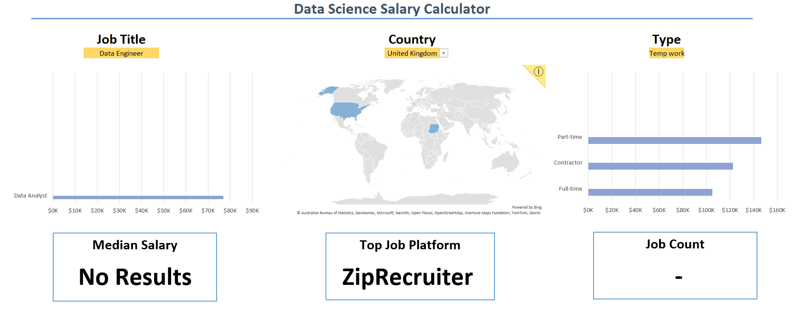
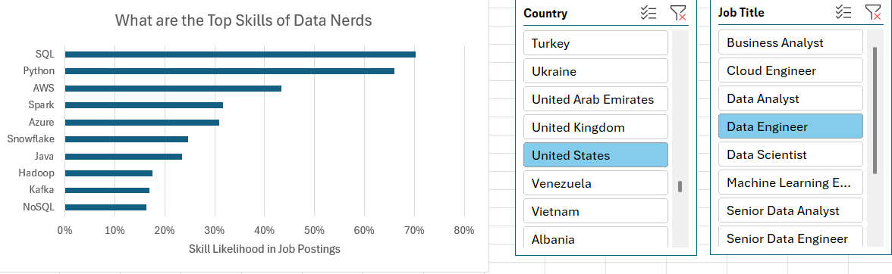
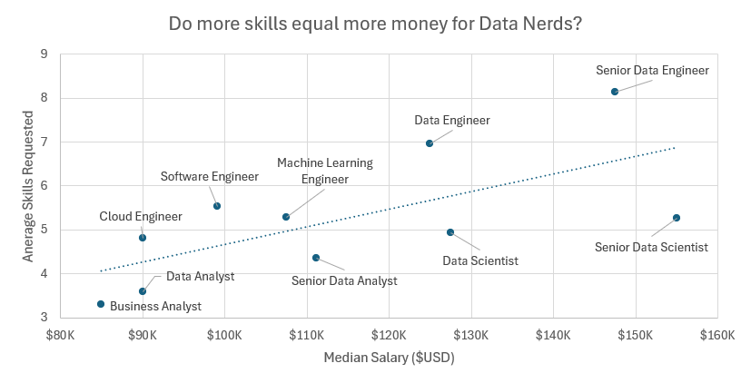
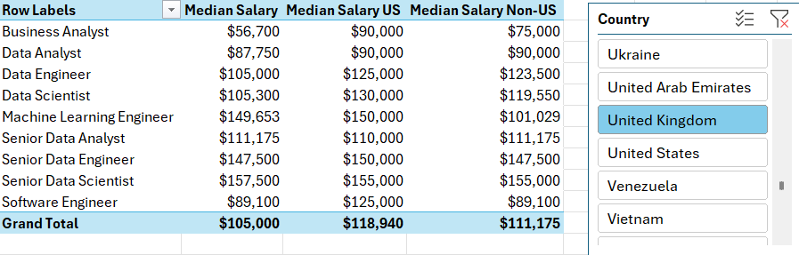
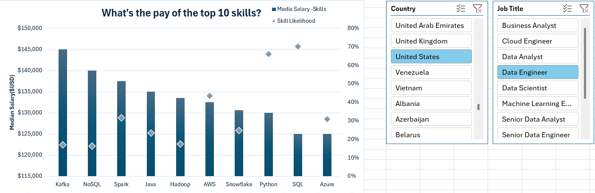

# 📊 Excel Data Analytics Projects: Job Market & Salary Analysis

I'm learning data analytics. I built these two Excel projects as part of Luke Barousse's [Excel Data Analytics Course](https://github.com/lukebarousse/Excel_Data_Analytics_Course), using **32,000+ data job postings** to explore what data jobs pay and which skills employers want.

---

## 📁 Project 1: Interactive Salary Dashboard
**File:** `1-Salary_Dashboard.xlsx`

An interactive salary calculator. Choose a **job title, country and job type** to see the **median salary**, the **top job platform** and the **job count**, with charts and a map.

### 🛠️ Excel Skills Used
- 📉 Charts
- 🧮 Formulas and Functions
- ❎ Data Validation

---

## 📁 Project 2: Job Market Data Analysis
**File:** `1-Project_Analysis.xlsx`

I analyzed the job postings to answer three questions: **Which skills are most in demand? What do data jobs pay? Which skills pay the most?**

### 🛠️ Excel Skills Used
- 📊 PivotTables
- 📈 PivotCharts
- 🔍 Power Query
- 💪 Power Pivot
- 🧮 DAX

### 1️⃣ Job Skills Analysis

- **SQL (70%)** and **Python (66%)** are the most requested skills
- **AWS (43%)**, **Spark (32%)** and **Azure (31%)** come next

### 2️⃣ Salary vs. Skills

- Senior Data Engineers ask for the most skills per job (about 8), with a median salary of about **$148K**
- Data Analysts ask for about 3.6 skills per job, with a median salary of about **$90K**

### 3️⃣ Salary Analysis (US vs. Non-US)

- The median salary is **$118,940** in the US and **$111,175** outside the US
- Senior Data Scientist is the highest in the US at **$155K**
- Machine Learning Engineer pays **$150K** in the US but **$101K** outside it, while Data Analyst pays about the same in both

### 4️⃣ Skill Salary Analysis

- **Kafka ($145K)** and **NoSQL ($140K)** have the highest median salaries among skills, even though they appear in fewer postings
- **SQL ($125K)** and **Python ($130K)** appear in the most postings

---

## 🧠 What I Learned
- Building an interactive dashboard in Excel
- Dropdown lists with Data Validation
- Writing formulas that connect dropdown choices to results (`XLOOKUP`)
- Loading and preparing data with Power Query
- Connecting tables with Power Pivot and writing DAX measures
- Summarizing data with PivotTables, PivotCharts and slicers
- Turning numbers into clear charts and insights

## 🎯 Takeaway
These projects taught me to turn raw data into clear answers in Excel. My analysis showed that SQL and Python are the skills employers ask for most, which helps me decide what to learn next.

---

## 🚀 How to Use
1. Download this repository.
2. Open `1-Salary_Dashboard.xlsx` and try the salary calculator.
3. Open `1-Project_Analysis.xlsx` to explore the PivotTables and charts.

*Tip: use Excel 365 or Excel 2021+ so all features work.*

---

**Mana Al Balharith** · [LinkedIn](https://www.linkedin.com/in/mana-al-balharith)